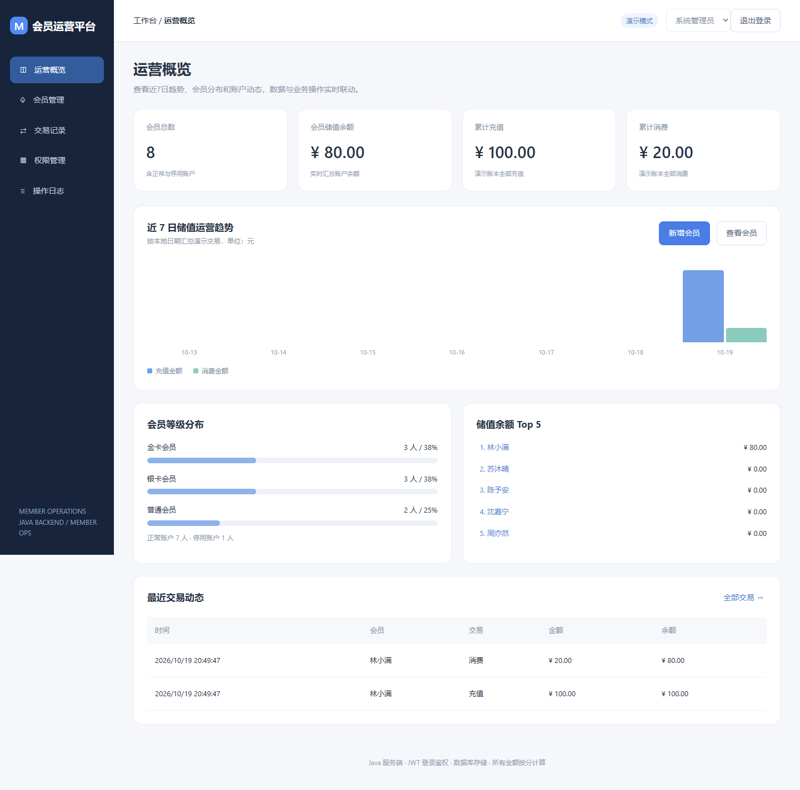
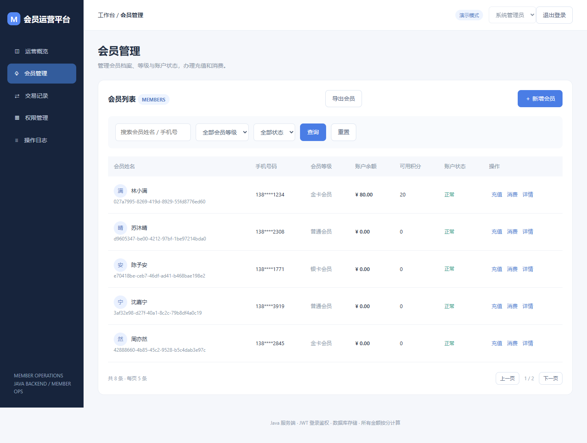
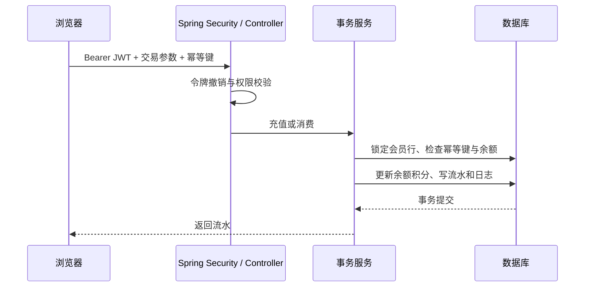

# 会员卡运营平台

Java 前后端一体的会员储值运营练习项目。提供登录、会员档案、充值消费、交易流水、角色权限、操作日志和运营概览。

此仓库实现的是可运行的新版本：Spring Boot + Spring Security + JWT + Spring JDBC，支持 H2 和 MySQL。前端使用原生 HTML / CSS / JavaScript，由 Java 服务提供静态文件。**本仓库未使用 MyBatis、Redis 或真实支付渠道，不把它们列为已经实现的功能。**

## 页面预览





截图来自本地 Java 服务，包含虚构演示会员和测试交易。

## 快速运行

需要 JDK 17 或更高版本、Maven 3.6.3 或更高版本。

```bash
mvn test
mvn spring-boot:run
```

打开 http://127.0.0.1:8080 。无需另装数据库；默认使用文件型 H2，数据位于 `data/`，重启保留。首次启动生成三种账号以及 8 位虚构会员，会员初始余额为零。

| 用户名 | 默认本地密码 | 权限 |
| --- | --- | --- |
| admin | local-demo-change-me | 全部业务及角色管理 |
| clerk | local-clerk-change-me | 会员维护、充值消费和流水查询 |
| viewer | local-viewer-change-me | 只读会员与流水查询 |

这些是仅用于本地开发的公开默认值。应用默认只监听 `127.0.0.1`。公网部署前设置三个账号密码和 JWT 密钥，启用 HTTPS，并按实际环境补充登录限流、监控、备份。初始化账号只在空数据库创建；修改环境变量不会重置已有密码。

也可以打包运行：

```bash
mvn clean package
java -jar target/member-card-platform-1.0.0.jar
```

## MySQL 配置

创建空数据库 `member_platform`，为应用创建最小必要权限的数据库用户。应用读取 `src/main/resources/schema.sql` 初始化表。

PowerShell 示例（请替换环境变量值）：

```powershell
$env:SPRING_PROFILES_ACTIVE='mysql'
$env:DB_URL='jdbc:mysql://127.0.0.1:3306/member_platform?useUnicode=true&characterEncoding=UTF-8&serverTimezone=Asia/Shanghai'
$env:DB_USERNAME='member_app'
$env:DB_PASSWORD='<数据库密码>'
$env:ADMIN_PASSWORD='<至少12字符>'
$env:CLERK_PASSWORD='<至少12字符>'
$env:VIEWER_PASSWORD='<至少12字符>'
$env:JWT_SECRET='<至少32字节的随机密钥>'
mvn spring-boot:run
```

默认本地模式未指定 JWT 密钥时，每次启动生成随机密钥，重启后旧令牌失效。指定固定密钥后，令牌有效期为一小时；退出登录会把令牌标识写入数据库撤销表。

## 业务功能

- **运营概览**：最近七日充值消费趋势、会员等级分布、余额排行和最近交易，均从数据库加载后的数据计算。
- **会员管理**：搜索、等级状态筛选、分页、新增、编辑、详情、账户停用恢复。
- **充值消费**：服务端参数校验；金额以整数“分”存储；事务内更新余额、积分、流水和成功操作日志；消费余额不足或账户停用时拒绝。
- **交易记录**：按姓名、流水号、类型、日期筛选，查看交易前后余额和积分；有导出权限的用户可在浏览器生成 CSV。
- **角色管理**：管理员配置门店操作员与观察员的权限；服务端每次请求从数据库读取当前权限，管理员角色固定。
- **操作日志**：追溯成功的业务变更和角色变更；失败请求以 HTTP 错误返回，不记录成功审计。前端筛选不改变服务端权限检查。

当前列表数据一次加载，再由浏览器分页筛选，适合小规模展示。生产规模需要进一步实现服务端分页、导出接口及日志保留策略。当前不提供退款、支付网关、对账、真实员工账号管理或生产级审计。

## 一致性设计

`MemberService.transact()` 在事务中执行 `SELECT ... FOR UPDATE` 锁定会员行，再读取余额并更新余额、积分、流水及审计日志。并发消费同一账户时串行校验，避免超额扣减。交易请求要求幂等键；同一用户对相同会员、类型、金额的相同幂等键返回原流水，不重复入账。跨会员复用幂等键由唯一约束拒绝。



## 目录

```text
src/main/java/com/fangfang/member/
  AuthController.java       登录、当前用户、退出
  SecurityConfig.java       JWT 验签、数据库权限转换
  ApiController.java        会员、交易、角色、日志 API
  MemberService.java        业务事务与一致性
  Bootstrap.java            开发数据初始化
  ApiExceptionHandler.java  参数与业务错误返回
src/main/resources/
  static/                   已接入后端的前端页面
  application.yml           H2 / MySQL 配置
  schema.sql                表结构
src/test/java/               集成测试
docs/API.md                  API 说明
```

## 测试

`mvn test` 覆盖未登录访问、只读角色权限、退出令牌撤销、充值幂等、余额不足、账户停用和并发消费防超扣。测试使用内存 H2；MySQL 配置需要连接实际数据库进行额外验证。

`maven-local-settings.xml` 用于本任务环境的 Maven 缓存路径，不需要上传到仓库；通常直接运行标准 Maven 命令即可。
