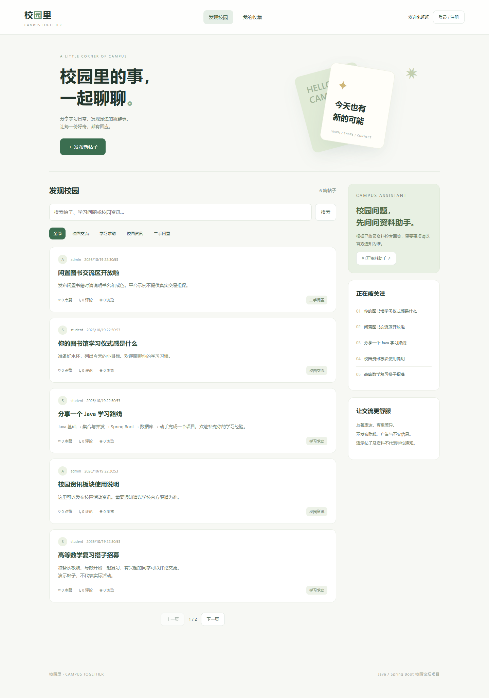
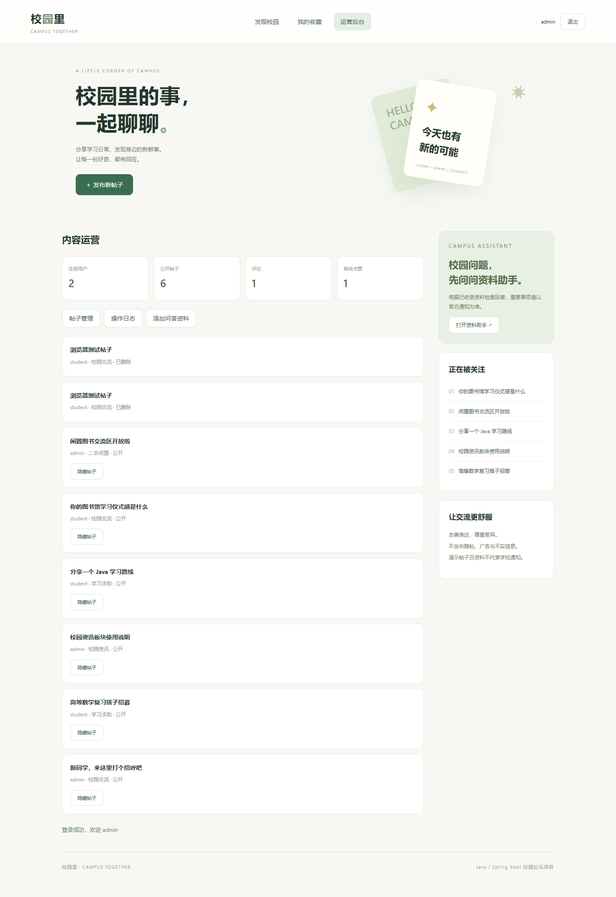

# 校园里 · AI 辅助校园交流平台

面向校园交流、学习互助、资讯分享与闲置交流的 Java 全栈项目。围绕“内容发布—互动反馈—后台治理”构建论坛业务，并接入 DeepSeek 资料问答，帮助用户从已维护的知识资料中获取带来源的回答。

**技术栈：** Java 21 · Spring Boot · Spring Security · MyBatis · MySQL · Redis · RabbitMQ · Spring Cloud Gateway · Nacos · DeepSeek API · HTML / CSS / JavaScript

## 页面预览

### 论坛首页



### 管理后台



## 核心功能

| 模块 | 功能 |
| --- | --- |
| 账号与权限 | 邮箱验证码注册、JWT 登录、退出令牌撤销、普通用户与管理员权限控制 |
| 内容交流 | 分类浏览、关键词搜索、服务端分页、帖子发布与编辑、作者删除、评论 |
| 用户互动 | 点赞、收藏、个人收藏列表、互动数据异步同步、热榜 |
| 运营管理 | 内容审核与恢复、运营统计、操作日志、知识资料维护 |
| AI 资料助手 | 相关资料检索、DeepSeek 回答生成、参考来源展示、资料不足时明确提示 |

## 关键技术设计

### 1. 基于 Redis 的互动异步落库

点赞与收藏接口接收明确的目标状态，避免重复请求导致状态反复切换。通过 Redis Lua 原子更新互动状态、版本号和待同步集合，定时任务将数据写入 MySQL；同步完成后，仅在版本未变化时清除待同步标记，防止覆盖后续操作。

### 2. 缓存与热点访问

帖子详情使用 Redis 缓存，结合随机过期时间分散集中失效；通过带持有者标识的互斥锁控制缓存重建。编辑、删除和互动同步会清理相关缓存，公开状态检查确保被审核隐藏的帖子不继续通过旧缓存展示。热榜使用 Redis Sorted Set 维护互动热度。

### 3. RabbitMQ 异步验证码邮件

注册验证码请求在数据库事务中写入验证码摘要与 Outbox 记录，后台任务投递 RabbitMQ，由消费者执行 SMTP 发送。结合投递标识、有效期检查和有限重试处理异常，缩短注册接口等待时间。验证码通过后使用事务与行锁完成一次性消费。

### 4. 认证、权限与审计

使用 Spring Security 与 JWT 实现接口鉴权，BCrypt 保存密码摘要。服务端校验帖子作者权限及管理员角色，退出时记录令牌撤销状态；对登录、发帖、评论等接口使用 Redis Lua 限流，关键业务操作写入审计日志。

### 5. 带资料来源的 AI 问答

先检索相关知识资料并限制上下文长度，再调用 DeepSeek 生成回答；通过 SSE 事件向页面返回模式、来源、答案与完成状态。未找到相关资料时直接提示，不发起模型请求；模型密钥由后端读取，浏览器不持有密钥。

### 6. 网关与服务发现

使用 Spring Cloud Gateway 与 Nacos 完成服务注册、发现和路由。业务应用可按认证、内容、互动、运营、日志五种角色启动独立进程，复用业务代码并共享 MySQL Schema；同时保留一体运行模式，便于开发和演示。

## 技术栈与模块

| 层次 | 技术 |
| --- | --- |
| 后端 | Java 21、Spring Boot 3.5、Spring Security、JWT、MyBatis |
| 数据与消息 | MySQL 8、Redis、RabbitMQ、SMTP |
| 服务协作 | Spring Cloud Gateway、Nacos |
| 智能问答 | DeepSeek API、知识资料检索、SSE |
| 前端 | 原生 HTML、CSS、JavaScript |
| 工程与测试 | Maven、JUnit、Spring Boot Test、Docker、GitHub Actions |

```text
campus-forum/
├── forum-service/       论坛业务、鉴权、资料助手与前端
├── gateway/             网关路由与 Nacos 服务发现
├── agent-service/       Spring AI / Ollama / Milvus 扩展模块
├── docs/                API、运行说明与测试记录
├── compose.yml          开发环境服务编排
└── compose.local.yml    本机中间件环境
```

当前可运行的问答方案为 DeepSeek＋资料检索；向量检索扩展模块的环境要求与验证状态见[验证记录](docs/VERIFICATION.md)。

## 快速体验

需要 JDK 21+、Maven 3.6.3+。默认使用文件型 H2，可先体验论坛基础功能，再配置 MySQL、中间件和在线模型。

```bash
cd campus-forum
mvn test
mvn -pl forum-service spring-boot:run
```

打开 [http://127.0.0.1:8081](http://127.0.0.1:8081)。首次运行会初始化演示账号与示例内容。

| 演示账号 | 本地开发密码 | 角色 |
| --- | --- | --- |
| student | local-student-change-me | 普通用户 |
| admin | local-admin-change-me | 管理员 |

这些账号仅用于本地演示；其他环境应配置独立的账号密码和 JWT 密钥。

## 测试与工程质量

- 自动集成测试覆盖注册、鉴权、作者权限、互动、审核及问答接口，共 10 项测试通过。
- 已验证 MySQL、Redis、RabbitMQ 邮件链路，以及 Nacos 注册、网关非 AI 路由和服务重启恢复。
- 已完成 DeepSeek 真实资料问答调用与参考来源校验。
- 提供本机短时并发测试脚本与结果，并通过 GitHub Actions 执行自动构建和测试。

## 项目文档

- [接口说明](docs/API.md)
- [中间件与本机运行](docs/DOCKER-LOCAL.md)
- [在线模型配置](docs/ONLINE-AI.md)
- [测试与验证范围](docs/VERIFICATION.md)
- [并发测试记录](docs/CONCURRENCY.md)

数据库凭据、模型密钥及本机运行数据通过独立配置管理，不随源码分发。
