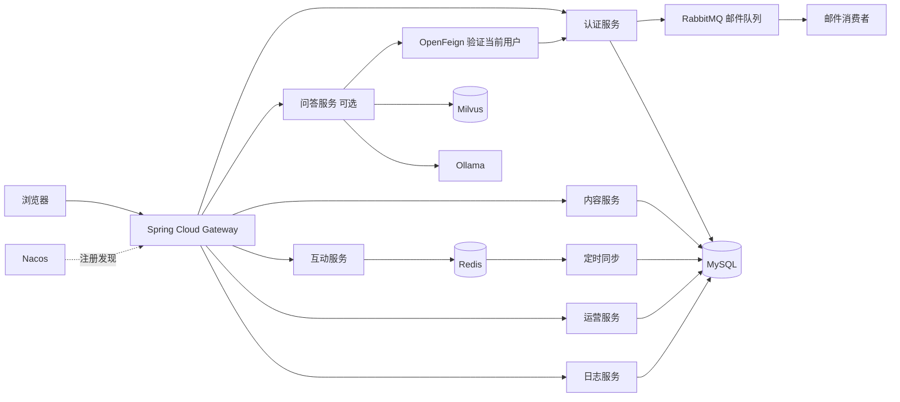

# 校园里 校园论坛

面向校园交流、学习求助、校园资讯和闲置交流的 Java 前后端项目。项目提供本地一体运行模式，以及网关、服务注册、Redis、RabbitMQ 和 AI 服务的扩展配置。

**本目录仅分发源码与示例配置；真实密钥、加密凭据、本机数据、日志和编译产物均不入仓库。**

## 本机真实联调（2026-10-20）

已完成现有MySQL＋Docker Redis/RabbitMQ/Mailpit的真实业务联调，以及Nacos注册、网关非AI路由的分批验证。应用、Nacos、网关、Redis/RabbitMQ的服务重启恢复已验证。默认日常使用低内存联调版：双击 `start-docker-local.cmd`，访问 http://127.0.0.1:8083 。环境准备、加密凭据和分批启动步骤见 [本机运行说明](docs/DOCKER-LOCAL.md)，实际验证边界见 [验证记录](docs/VERIFICATION.md)。

在线DeepSeek资料问答已完成一次真实调用及来源校验；Ollama/Milvus独立agent仍未真实验证，已完成150次有界只读并发测试，结果见 [并发测试记录](docs/CONCURRENCY.md)；未做生产部署或全服务同时压测。运行 `python prepare-source.py` 可生成排除本机凭据、数据和编译产物的源码包，不会创建或上传Git仓库。

## 页面预览


## 本地运行

需要 JDK 21+、Maven 3.6.3+。本地模式使用文件型 H2，无需安装 Redis、RabbitMQ 或大模型。

```bash
mvn test
mvn -pl forum-service spring-boot:run
```

浏览器打开 http://127.0.0.1:8081 。默认仅监听本机。账户数据、帖子、评论和互动保存在启动目录下的 `data/forum` 数据库文件，重启保留。

| 账号 | 本地开发密码 | 权限 |
| --- | --- | --- |
| student | local-student-change-me | 发帖、编辑删除自己的帖子、评论、点赞、收藏、资料问答 |
| admin | local-admin-change-me | 普通用户功能、内容审核、运营统计、操作日志、知识资料添加 |

首次启动生成虚构演示帖子及一条使用说明；它们不是学校的真实通知。示例邮箱使用 `.test` 域名，不会给真实学生发送邮件。

注册时，本地模式会在页面显示开发验证码，5 分钟有效。这仅用于本地体验；MySQL 部署模式禁止返回验证码。用户名为 3 至 30 位字母、数字、下划线，密码为 12 至 72 字符。

## 模块与运行方式

```text
campus-forum/
  forum-service/    Spring MVC 论坛业务、MyBatis、鉴权和前端
  gateway/          Spring Cloud Gateway 路由、Nacos 服务发现
  agent-service/    Spring AI、Ollama、Milvus、OpenFeign、Sentinel
  compose.yml       MySQL、Redis、RabbitMQ、Nacos 与服务进程
  docs/             API、架构、验证记录
```

`forum-service` 在本地以 `SERVICE_MODE=all` 运行所有论坛模块。中间件模式使用同一个经过构建的业务 JAR 启动五个独立服务进程：`auth`、`content`、`interaction`、`operations`、`log`，分别启用对应的 Controller，通过 Nacos 注册并由网关分发请求。这是一种按角色部署的共享代码方案，**不是五个独立源码仓库**；当前也共享同一个 MySQL Schema，未实现各服务独立数据所有权。



## 已实现的业务代码

- 分类浏览、关键词搜索、MyBatis 动态 SQL、参数化查询和服务端分页；正文按纯文本展示。
- 邮箱验证码注册、BCrypt 密码校验、JWT 登录、数据库令牌撤销表，以及中间件模式的 Redis 黑名单写入。
- 仅作者可以编辑或删除自己的帖子；管理员可隐藏与恢复公开帖子，隐藏内容不再通过公开详情访问。
- 评论、点赞和收藏；接口接收明确的目标状态，不依赖不稳定的反复切换操作。本地模式写数据库，中间件模式写入 Redis 版本与脏数据集合，定时按版本同步数据库，失败保留待重试项。
- Redis 热榜、详情缓存、互斥缓存重建，以及本地模式数据库热度计算；缓存详情前先检查帖子是否公开，防止审核后继续读取旧缓存。
- 发送验证码、登录、发帖、评论和问答频率限制。中间件模式使用 Redis Lua，开发模式使用进程内固定窗口。
- 后台统计、帖子审核、最近操作日志及知识资料添加。成功的关键操作记录审计数据。
- RabbitMQ 异步邮件消费者、数据库 Outbox 和有限重试；SMTP 在后台线程执行，不阻塞验证码请求。
- 本地资料检索与 SSE 输出；可选 Spring AI 服务实现 Ollama + Milvus 检索增强生成、资料分块、重叠片段、来源输出及 Sentinel QPS 限制。

## AI 模式的界限

本地默认页面会明确标注“资料检索模式：非大模型生成”，按双字片段匹配返回资料，不伪装成 RAG。真正的向量检索和模型生成由独立 `agent-service` 提供，需要运行 Ollama、Milvus 并准备模型。

AI 服务提供单轮问答，检索上限为 4 段，参考资料裁剪至 7000 字符；没有实现简历中提到的多轮消息摘要压缩。前端为原生 HTML/CSS/JavaScript，未使用 Vue 3 或 Element Plus；分页使用 MyBatis SQL 的 `LIMIT/OFFSET`，没有引入 MyBatis-Plus 或 PageHelper。请以实际源码和验证记录为准描述项目。

## 中间件部署

构建全部模块：

```bash
mvn -Pcloud,ai package
```

复制 `.env.example` 为 `.env`，替换密码和至少 32 字节的 JWT 密钥后：

```bash
docker compose up --build
```

论坛入口：http://127.0.0.1:8082 。邮件开发收件箱：http://127.0.0.1:8025 。验证码邮件被 Mailpit 捕获，不会向外投递；要真实发送邮件，需替换 SMTP 配置。Nacos、Redis、数据库和 RabbitMQ 仅在 Docker 网络内开放，不发布管理端口。

所有业务服务必须使用相同 JWT 密钥。默认本地模式未提供密钥时每次启动会生成随机密钥，因此重启会使旧令牌失效。

### 启用真正的 RAG

先准备可访问的 Milvus 实例，在 `.env` 设置 `MILVUS_HOST`，再启动 AI Profile：

```bash
docker compose --profile ai up --build
docker compose exec ollama ollama pull qwen2.5:3b
docker compose exec ollama ollama pull nomic-embed-text
```

模型下载完成后重启 `agent-service`。嵌入模型应输出 768 维向量，模型变更时需要匹配 Milvus 集合维度。管理员在页面添加资料后方可提问。Milvus 官方部署示例见 [官方 Docker Compose](https://github.com/milvus-io/milvus/blob/v2.5.10/deployments/docker/standalone/docker-compose.yml)。

Docker 配置是本地开发拓扑。公网运行还需 TLS、真实域名、密钥管理、账号管理、可靠备份和监控。当前项目没有上传或上线。

## 一致性与限制

- Redis 互动使用版本字段；同步完成后仅在版本未变化时移除脏标记。生产环境仍应验证 Redis 故障恢复、持久化与多实例场景。
- 邮件 Outbox 提供有限重试及投递标识；SMTP 外部副作用与数据库提交无法构成分布式事务，崩溃窗口内可能重复发送。并非“严格恰好一次”。
- 微服务模式使用共享数据库和同一个业务应用包，不宣称已经实现数据库隔离、独立演进或完整服务治理。
- 多实例邮件队列及 Redis 等外部服务的验证情况见 `docs/VERIFICATION.md`，不可把编译成功等同于部署成功。
# 无 Docker 在线问答

单体论坛新增可选在线模型接口，操作步骤见 [docs/ONLINE-AI.md](docs/ONLINE-AI.md)。可运行 `configure-ai.ps1` 在本地配置，默认关闭；真实密钥不进入代码。已完成DeepSeek真实资料问答验证；密钥通过本地窗口加密配置，不随源码分发。

