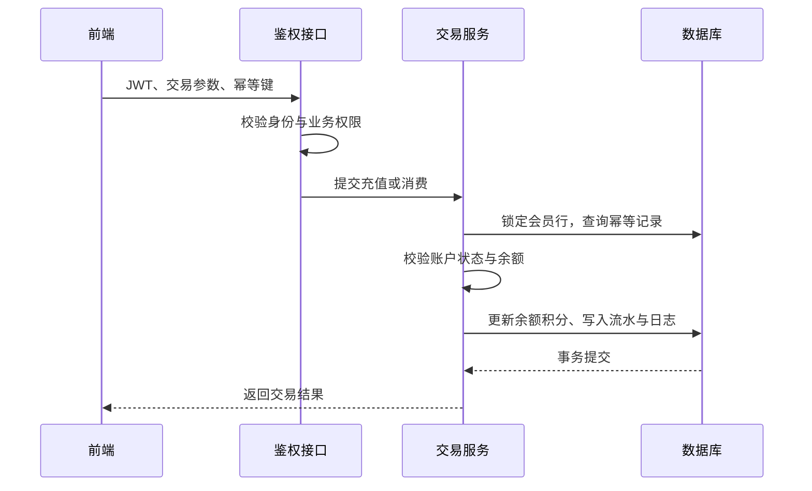

# 会员卡运营平台

面向门店会员储值与日常运营的 Java 全栈项目，覆盖会员建档、充值消费、积分累计、交易追溯、角色授权和运营分析。围绕账户资金变更，重点实现事务一致性、重复请求幂等与并发扣款校验。

**技术栈：** Java 17 · Spring Boot · Spring Security · JWT · Spring JDBC · MySQL / H2 · HTML / CSS / JavaScript · Maven · JUnit · GitHub Actions

## 页面预览

### 运营概览


### 会员管理


## 核心功能

| 模块 | 功能 |
| --- | --- |
| 运营概览 | 近七日充值消费趋势、会员等级分布、余额排行、最近交易 |
| 会员管理 | 会员新增与编辑、关键词搜索、等级与状态筛选、分页、账户停用与恢复 |
| 储值交易 | 充值、余额消费、积分联动、余额不足校验、重复请求处理 |
| 交易记录 | 按会员、流水号、类型和日期筛选，查看变更前后余额，CSV导出 |
| 角色权限 | 管理员、门店操作员、观察员三类角色，支持配置业务权限 |
| 操作日志 | 记录成功的会员、交易和权限变更，关联操作人及业务对象 |

## 关键技术设计

### 1. 账户资金变更的事务一致性

余额和交易金额统一以整数“分”存储。充值与消费在同一数据库事务内更新会员余额、积分、交易流水和审计日志，避免资金状态与业务记录分离。

### 2. 行锁控制并发扣款

通过 `SELECT ... FOR UPDATE` 锁定目标会员账户，获取锁后再检查账户状态和可用余额。并发消费同一账户时，按锁顺序重新读取余额并执行校验，防止基于旧余额重复扣减。

### 3. 交易幂等与请求冲突校验

交易请求携带幂等键，并结合操作人生成请求标识。同一笔请求重试时返回已有流水，不重复入账；若复用幂等键但会员、交易类型或金额不同，则拒绝处理。数据库唯一约束为幂等标识提供最终保护。

### 4. 服务端权限控制

使用 Spring Security 与 JWT 完成认证，服务端按当前数据库权限校验业务请求。角色配置变更后，后续请求按更新后的权限执行；退出登录将令牌标识写入撤销表，避免客户端清除令牌后旧令牌仍可继续使用。

### 5. 业务流水与操作追溯

交易记录保存操作人、业务类型、金额、变更前后余额及积分变化；成功操作在同一事务中记录日志，便于从会员账户追溯到具体流水与操作行为。

## 交易处理流程



## 项目结构

```text
member-card-platform/
├── src/main/java/com/fangfang/member/
│   ├── AuthController.java        登录、身份查询与退出
│   ├── SecurityConfig.java        JWT验证与动态权限校验
│   ├── ApiController.java         会员、交易、角色与日志接口
│   ├── MemberService.java         业务事务与交易一致性
│   └── Bootstrap.java             演示数据初始化
├── src/main/resources/
│   ├── static/                   前端页面与交互
│   ├── application.yml           运行配置
│   └── schema.sql                数据表结构
├── src/test/java/                自动集成测试
└── docs/                         接口、运行说明与页面截图
```

## 快速体验

需要 JDK 17+、Maven 3.6.3+。默认使用文件型H2，无需额外安装数据库；也支持切换MySQL。

```bash
cd member-card-platform
mvn test
mvn spring-boot:run
```

打开 [http://127.0.0.1:8080](http://127.0.0.1:8080)。首次启动初始化演示账号与示例会员，业务数据持久化至 `data/`。

| 演示账号 | 本地开发密码 | 权限 |
| --- | --- | --- |
| admin | local-demo-change-me | 全部业务及角色管理 |
| clerk | local-clerk-change-me | 会员维护、充值消费、流水查询 |
| viewer | local-viewer-change-me | 会员与流水只读 |

演示账号只用于本地体验，其他环境应通过配置提供独立密码与JWT密钥。

## 测试与工程质量

自动集成测试覆盖未登录访问、只读角色权限、退出令牌撤销、交易幂等、余额不足、账户停用，以及并发消费防超扣。项目通过GitHub Actions执行自动构建与测试。

## 项目文档

- [接口说明](docs/API.md)
- [数据库配置与实现范围](docs/RUNNING.md)

数据库密码、JWT密钥和本机运行数据不随源码分发。
